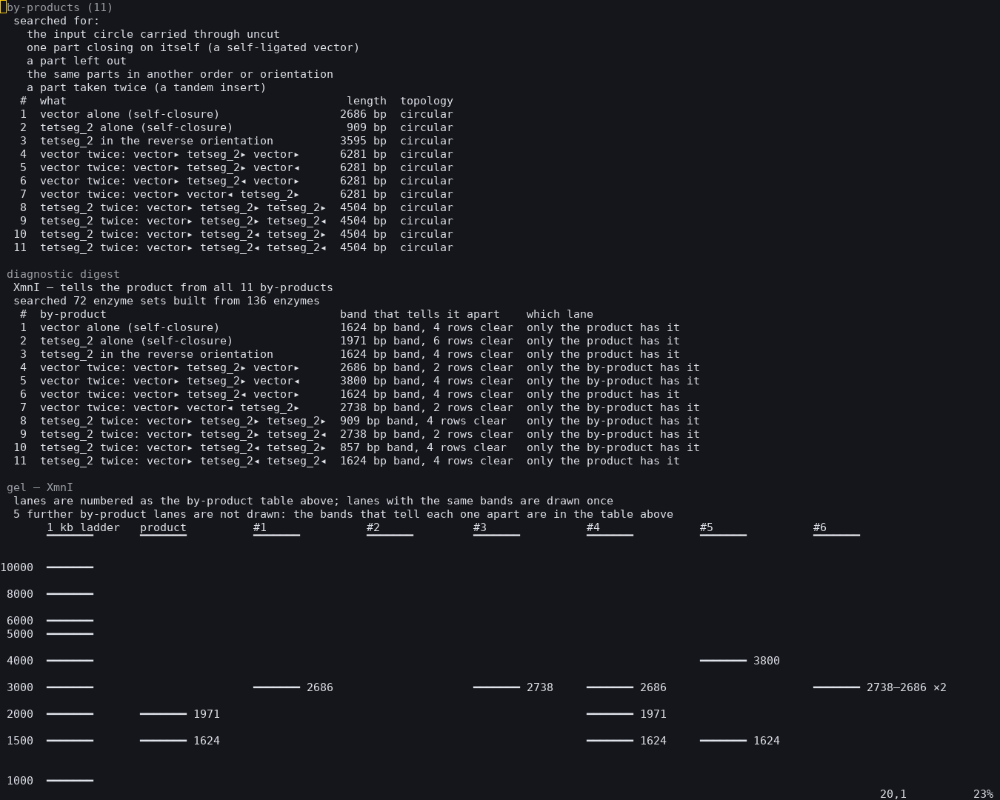
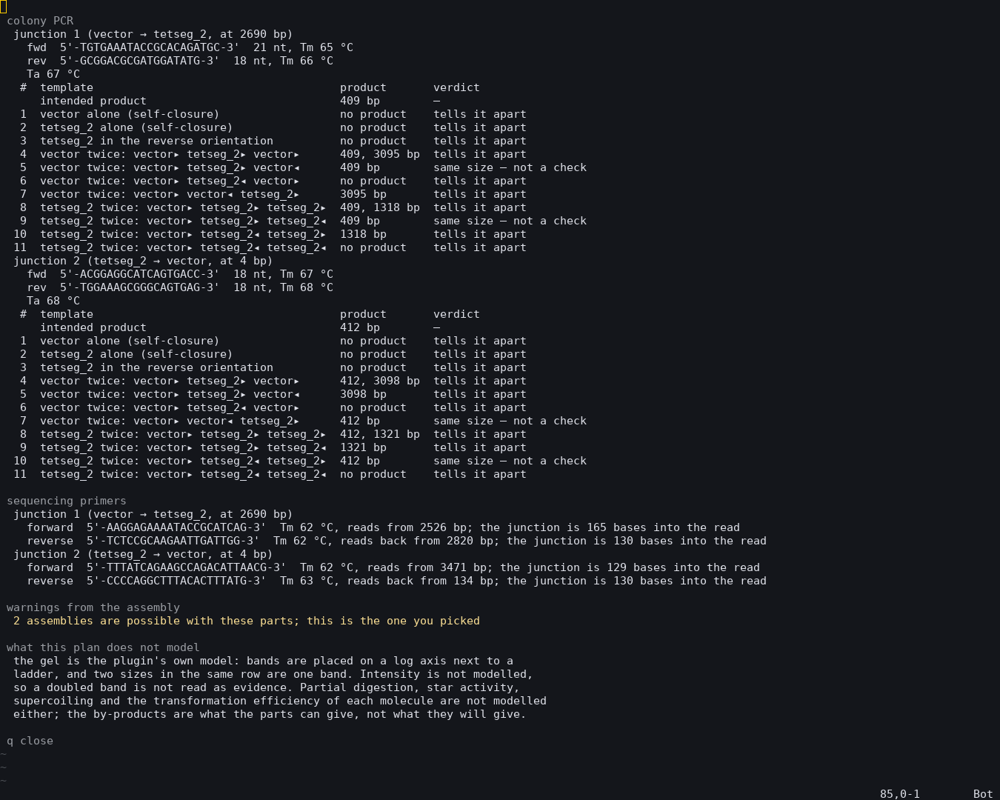

# The assembly plan

`lua/plasmid/cloneplan.lua` turns a finished assembly into the document a
cloner writes before touching a pipette. The assemblers already produce a
product record and, on failure, a report of every end pair they tried; neither
answers the questions that come next. What goes in the tube, what should come
out, **what else could come out**, and how to tell those apart once there are
colonies on the plate.

The command is `:DnaClonePlan [path]`, `!` to write beside the source record
under the product's name. The report split and the file hold the same text.

Every number below was measured in this session, on Neovim 0.12.2, headless,
one core, by `tests/tools/cloneplan_bench.lua` and the specs.

## What the plan contains

Decided before any of it was written, and in this order, because it is the
order the questions arise in:

1. **reaction** — the method, its enzyme, the number of parts, and what joins
   them (ligase by the ends the parts have; a Type IIS enzyme's overhangs in
   one pot; terminal homology of at least `cloning.min_homology`).
2. **parts** — per part: its length, *where it came from* (the staged part's
   own provenance: a digest of a named record, a file, a selection), *how it
   was prepared* (the enzymes whose cuts bound it, taken from the digest
   fragment's own site records; the primers that amplified it, taken from its
   `primer_bind` features; or that it went in whole), the strand it is used
   on, and both ends in the digest table's notation (`5′ AATT`, `3′ TGCA`,
   `blunt`).
3. **expected product** — name, length, topology, and every junction: which
   part meets which, the overhang or the overlap, and **the base of the
   product it sits at**. The coordinates matter: they are what the primer
   sections below are built from, and what a reader checks a sequencing trace
   against.
4. **by-products** — the families searched, named whether or not anything was
   found in them, then every molecule found, with its length and topology.
5. **diagnostic digest** — the set, what each by-product is told apart by, and
   the gel.
6. **colony PCR** — a pair per junction, with its size on the product and on
   every by-product, and a verdict per by-product.
7. **sequencing primers** — one each way across each junction, with where the
   read starts and how far into it the junction falls.
8. **warnings from the assembly**, carried through from the assembly report.
9. **what this plan does not model**, in the report itself rather than only in
   this document, because that is where it will be read.

The style follows the assembly report in `clone.lua`: a title line, then
named lower-case sections of small aligned tables. The written file is the
report's own lines, which is why the one empty table header the first draft
emitted had to go — a header of nothing is a line of trailing spaces, and the
file would have carried it where the buffer did not.

## By-products

`A.assemble` enumerates assemblies that use **each fragment exactly once**.
That is the right contract for an assembler and the wrong one for a screen:
the background a cloner plates against is mostly a part *missing* or a part
*doubled*. So the plan runs the same assembler over sub- and multisets of the
same fragments, with the same join rule and the same topology requirement, and
keeps what it builds. A by-product is therefore a molecule the engine really
builds, never a guess.

The families, all of them named in the report whether or not they yield
anything:

| family | how it is enumerated |
|---|---|
| the input circle carried through uncut | a staged part whose record was circular, copied as is |
| one part closing on itself | `A.assemble` on each single fragment |
| a part left out | `A.assemble` on every proper subset of two or more (all subsets up to `max_parts` = 6 parts, only the largest otherwise) |
| another order or orientation | `A.assemble` on the full set; anything but the product |
| a part taken twice | `A.assemble` on the full set with one fragment repeated |

Two molecules are the same molecule when they have the same length and one
reads inside the other's doubled sequence, or inside its reverse complement —
a circle has no start and no preferred strand. The product is removed by the
same test, so a rotation of it is never listed as background.

The uncut input circle is the one entry that is not an assembly product. It is
in because it is the dominant background of any reaction into a cut
destination, the assembler can never report it, and leaving it out would make
the plan quietly optimistic. It is labelled as what it is.

The families are not symmetric across methods, and that asymmetry is a result
rather than an omission. A Gibson reaction with one arm at each end of both
parts gives four by-products — either part closing on itself, either part in
twice — and **no reverse orientation at all**, because a homology arm anneals
in one direction only. The same parts joined by one shared overhang give the
reverse orientation as the second-most likely outcome. A well-designed Golden
Gate gives neither: distinct fusion sites leave no part able to close on
itself and no alternative order, so its only by-product is the destination
carried through uncut. The specs assert each of those three shapes.

## The diagnostic digest

The heart of the track, and the part where it was easiest to be dishonest.

For every candidate enzyme set, each molecule — the product first, then every
by-product — is digested and its fragment lengths become a gel lane. The lanes
are handed to `plasmid.gel`, and **what the gel model places is what counts**:

* a band is where `gel.render` puts it, on the log axis next to the ladder it
  chose for those sizes;
* two sizes that land in the same row are **one band**, however different the
  two numbers look in a table;
* a size outside the ladder's range is placed nowhere and so shows nothing.

Two lanes are told apart only when one has a band in a row the other has not.
Nothing else is evidence. In particular a lane with two fragments in one row
(`2738–2686 ×2` in the gel below) is *not* treated as different from a lane
with one band there: the gel model draws the multiplicity, a real gel shows it
as intensity, and intensity is not something this plugin models.

Candidates are every enzyme in the active set (the bundled 222, or an imported
REBASE set) whose site has at least `cloning.plan.min_site` = 6 specific
bases, minus those that need methylated DNA — 136 of the bundled set. Sites
are scanned once per molecule and reused for every set, so the cost of a set
is one digest and one placement per lane.

Single enzymes are tried first, then pairs built from the best 24 singles,
then triples from the best 10 if `max_enzymes` is raised to 3. The search
stops at the first size that gives a *clear* answer, and a candidate is
preferred when, in order: it tells every by-product apart; it cuts the product
at all; every distinguishing band clears `min_gap` = 2 gel rows; it uses fewer
enzymes; it leaves fewer lanes uncut; it gives fewer bands.

Two of those deserve a word. **Cutting the product** is a gate because a set
that leaves the product whole gives one lane holding an uncut supercoiled
circle, which does not run at its linear size: "the product does not cut" is a
real Golden Gate check but it is not a band pattern, and the first draft of
the ranking happily offered BsmBI — the reaction's own enzyme — for exactly
that reason. **Two rows of clearance** outranks fewness of enzymes because a
band one row from its neighbour is a band the model can draw and a gel cannot
read; paying for a second enzyme is cheaper than a check that is read wrong.

Where a chosen set still leaves some molecule uncut, the plan says which, and
says that the lane is an uncut circle rather than a band at that size.

### When nothing discriminates

The search declines. It does not offer the best partial set as the answer. The
report instead:

* states that no set of up to `max_enzymes` enzymes tells the product from
  every by-product, and how many sets were searched from how many enzymes;
* **names each by-product that nothing distinguished**, with its length;
* gives the best partial check, labelled as telling *n* of *m* apart and as
  not a check for the rest;
* points at the colony PCR and the sequencing below.

This is not a theoretical branch. The second ligation in the bench is pUC19
cut with EcoRI plus a cassette whose insert is 40 bp. The two orientations of
that insert put the same 40 bases between the same two vector positions, so
every enzyme that cuts the vector gives identical fragment lengths for both,
and no six-cutter has a site inside 40 bp. After **338 enzyme sets from 136
enzymes** the search reports that PvuII is the best partial check, telling 7
of the 11 by-products apart, and that nothing distinguishes the insert in the
reverse orientation. That is the right answer, and the only honest one: the
check for that outcome is sequencing, not a gel.

## Colony PCR and sequencing primers

No design code lives in this module. For each junction, the window of
`cloning.plan.flank` = 200 bases either side of the junction base is handed to
`primerdesign.candidates` as the region to amplify — so the pair it returns
necessarily spans the junction — and its own scoring picks the pair. Sizes
come from `pcr.products` on the product and on every by-product record.

The verdict per by-product uses the same gel question as the digest: *can a
gel tell these two product sizes apart?* No product at all is a check. A
different size that resolves is a check. **The same size is not a check**, and
is printed as such, because that is precisely the row a reader would otherwise
skim past.

Sequencing primers are the same search over a window whose far edge is where
the read should start: `read_offset` = 150 bases before the junction forward,
and 150 after it reverse, so the junction falls past the first unreadable
bases of the trace. The plan prints where each read starts and how many bases
into it the junction is.

One tuning detail worth recording: `primerdesign`'s cost is quadratic in its
`slack` (it scores every forward against every reverse), so the plan asks
first with the design's own slack of 8 and only retries at 60 when nothing was
usable. The first draft asked at 80 throughout, and the two-junction ligation
plan below took 9,595 ms — 2,091 ms of colony-PCR design and 7,088 ms of
sequencing-primer design, against 20 ms to enumerate the by-products and 93 ms
to search the enzyme sets. Asking at 8 first brought the same plan, with the
same primers, to 1,148 ms. The retry only fires where a GC-rich base at the
nominal position would otherwise have produced "no pair" — a defect of the
plan rather than of the construct.

## A worked example

pUC19 (`L09137`, 2,686 bp) cut with EcoRI gives one 2,690 bp fragment (the
four overhang bases count into it). A 919 bp cassette carrying 901 bp of
pBR322 (`J01749` 1200..2100) between two EcoRI sites gives a 913 bp insert.
Every end is the same `AATT` overhang, so the ligation has two arrangements
and `:DnaLigate` offers both; the plan is for the one picked.

**Product** `vector_tetseg_2`, 3,595 bp circular. Junctions: `5′ AATT (4 bp)`
at bp 2,690 and at bp 4.

**11 by-products**, in the order the families are searched:

| # | what | length |
|---|---|---|
| 1 | vector alone (self-closure) | 2,686 bp |
| 2 | tetseg_2 alone (self-closure) | 909 bp |
| 3 | tetseg_2 in the reverse orientation | 3,595 bp |
| 4–7 | vector twice, four arrangements | 6,281 bp |
| 8–11 | tetseg_2 twice, four arrangements | 4,504 bp |

Note #3: the same length as the product. No gel lane of *uncut* molecules
could ever separate it, which is why the by-products are digested.

**Diagnostic digest: XmnI**, found after 72 enzyme sets built from 136
candidate enzymes. It cuts the product into 1,971 and 1,624 bp, and every
by-product either loses one of those two bands or gains one, between 2 and 6
gel rows clear of its nearest neighbour — for instance #1 (the self-ligated
vector) has no 1,624 bp band, and #5 gains one at 3,800 bp.

**Colony PCR across junction 1** — `TGTGAAATACCGCACAGATGC` (Tm 65 °C) and
`GCGGACGCGATGGATATG` (Tm 66 °C), Ta 67 °C — gives 409 bp on the product and
tells 9 of the 11 by-products apart: no product at all on #1, #2, #3, #6 and
#11, a second band on #4 and #8, a different single band on #7 and #10, and
**the same 409 bp on #5 and #9**, which the plan prints as "same size — not a
check". The digest does separate those two, so between the two checks the
eleven are covered. The pair across junction 2 is the mirror image: 412 bp,
9 of 11, the two it misses being #7 and #10.

**Sequencing**: the forward primer for junction 1 starts its read at bp 2,526,
putting the junction 165 bases in; the reverse reads back from bp 2,820,
putting it 130 bases in. Both are past the unreadable start of a trace.

`tests/tools/plan_shots.txt` reproduces both screens through a real terminal.

## Cost

`nvim -l tests/tools/cloneplan_bench.lua`, one run:

| assembly | product | by-products | answer | sets | by-products | digest search | colony PCR | sequencing | render | total |
|---|---|---|---|---|---|---|---|---|---|---|
| Golden Gate, BsmBI fixtures | 3,361 bp | 1 | BsrDI | 65 | 17 ms | 21 ms | 1,567 ms | 365 ms | 0.5 ms | **1,945 ms** |
| ligation, 901 bp cassette | 3,595 bp | 11 | XmnI | 72 | 19 ms | 100 ms | 200 ms | 912 ms | 1.1 ms | **1,065 ms** |
| ligation, 40 bp cassette | 2,745 bp | 11 | *none* | 338 | 21 ms | 191 ms | 224 ms | 387 ms | 1.4 ms | **759 ms** |

Primer design is the cost of a plan, not the by-product enumeration and not
the enzyme search — even the declining search, which evaluates 338 sets over
12 molecules, costs 191 ms. The Golden Gate row is slow because both of its
junction windows are GC-rich enough that the design's own slack of 8 finds no
pair and the 60-base retry fires for all four primers.

## What the specs check

`tests/spec/cloneplan_spec.lua`, 10 cases, about 10.6 s of the suite:

1. **Golden Gate** — method, enzyme, both parts with their provenance and
   `BsmBI digest` preparation, both 4-base fusion junctions, and that each
   junction's recorded base really holds that overhang in the product; the
   destination's uncut circle among the by-products; every section present in
   the written text.
2. **Gibson** — both junctions as 25 bp homology, both arms surviving in the
   product (so the length is `2·arm + backbone + body`), both parts prepared
   "whole record", both self-closures and a tandem among the by-products, and
   **no reverse orientation and no rearrangement at all**, which is the
   directionality of a homology arm stated as a test.
3. **restriction–ligation** — the self-closure, the reverse orientation and
   the tandems; pUC19 religated is 2,686 bp; the reverse orientation is the
   product's length and a tandem is longer; and every by-product is a distinct
   sequence.
4. **the search finds a set** — one or two enzymes, every by-product told
   apart, and then the claim is checked independently: for each by-product, a
   gel row that one lane has and the other has not, computed from the lanes
   rather than from the verdict. The product lane's bands are asserted to sum
   to the product's length, so the lanes really are a digest of that molecule.
5. **the search declines** — the 40 bp cassette: `plan.diagnostic` is nil, the
   by-product nothing distinguished is exactly the reverse orientation, a
   partial check exists and is marked partial, and the report says so in
   words.
6. **the gel rule on its own** — 1,000 against 500 resolves, 1,000 against
   1,010 does not, no product at all is a difference.
7. **colony PCR** — one product per junction on the product record, the
   junction base inside that product's template span, the reported size equal
   to `pcr.products`' own, every verdict equal to the gel question recomputed,
   and the self-ligated vector giving no product at all.
8. **sequencing primers** — each primer binds exactly once, on the strand and
   at the coordinate the plan reports, with the junction between 50 and 250
   bases into the read.
9. **the file** — written, readable, byte-identical to the report buffer bar
   the buffer's `q close` hint, containing the gel, and ending with a newline.
10. **no assembly** — the command reports rather than errors.

Suite: **440 passed, 0 failed** in both sequence layouts — 142.9 s grouped
(`PLASMID_TEST_GROUP=10`) and 141.4 s continuous (`PLASMID_TEST_GROUP=0`),
against 430 before this track.

## What is not modelled, and what I could not do

* **Band intensity.** A lane where two fragments share a gel row is drawn
  `×2` and read as one band. A real diagnostic digest is often read on
  intensity, and that is a genuine loss of discriminating power — it is stated
  in the report rather than approximated.
* **Supercoiling.** An uncut circle is placed at its linear size with a note
  that it does not run there. Where a chosen set leaves a molecule uncut the
  plan says the check is the absence of the product's bands, not a position.
* **Partial digestion and star activity.** Not modelled. A plan's by-products
  are what the parts *can* give, not what they will.
* **Transformation efficiency.** A 6 kb tandem and a 2.7 kb self-ligated
  vector are listed side by side; in a real transformation they are not
  equally likely. The plan ranks nothing by likelihood, because nothing here
  could justify a ranking.
* **Only up to two enzymes by default.** `max_enzymes = 3` searches triples
  over the best ten singles; beyond that the combinatorics are not worth it
  for a check that should be one tube.

Things the modules this track may not edit do not expose, worked around here:

* `A.build` computes each part's offset in the product and returns them, but
  `clone.lua` discards that return, so `M.offsets` recomputes the same
  arithmetic. One shared function in `bio/assembly.lua` would remove the
  duplication, and the junction coordinates in the plan depend on the two
  staying in step.
* `gel.render` is the only way to ask where a band lands. It builds the whole
  picture — lines, highlights, overflow notes — even when only the placement
  is wanted, and the declining search above calls it 338 times. A
  `gel.place(lanes, opts)` returning just `{ placed, off, row_of }` would make
  the search several times cheaper. Rendering and discarding was the
  workaround; the measured cost says it is affordable.
* `digest.compute` prepares the record on every call, so scanning 136 enzymes
  across 12 molecules through it would prepare 12 records 136 times over. The
  plan calls `R.prepare` once per molecule and `R.sites` per enzyme instead,
  which is the same work the digest does but hoisted.
* `A.assemble` asserts that no fragment is an intact circle and requires every
  fragment exactly once; both are right for an assembler, and both are why the
  by-product families are enumerated from outside it rather than asked of it.

One thing not done, deliberately. The EcoRI cassette the screenshot script
needs is a committed record, but it is in `tests/tools/`, not
`tests/fixtures/`: `io_spec` asserts that the number of feature lines across
every `.gb` fixture equals the number of features compared against the
Biopython oracle, so a new fixture needs a new `tests/oracle/expected/` entry
generated by another track's script. Putting the cassette beside the capture
script it belongs to avoids that coupling. The specs build their own copy of
the same insert from pBR322 rather than reading the file, so neither depends
on the other. Both EcoRI sites in that record are annotated at `3..8` and
`912..917`, which is where `GAATTC` actually reads — the first draft wrote
`4..9` and `911..916` and was off by one in each direction.

## Reproducing

    nvim -l tests/run.lua cloneplan                       # the specs
    nvim -l tests/tools/cloneplan_bench.lua bench.json     # the numbers above
    python tests/tools/tui_capture.py tests/fixtures/ncbi/L09137.gb \
      docs/screenshots/clone --script tests/tools/plan_shots.txt \
      --rows 60 --cols 150 --pre "set laststatus=0"        # the screenshots
