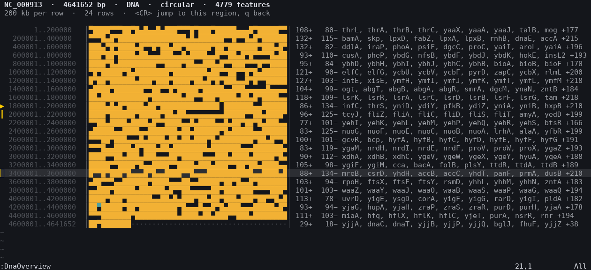
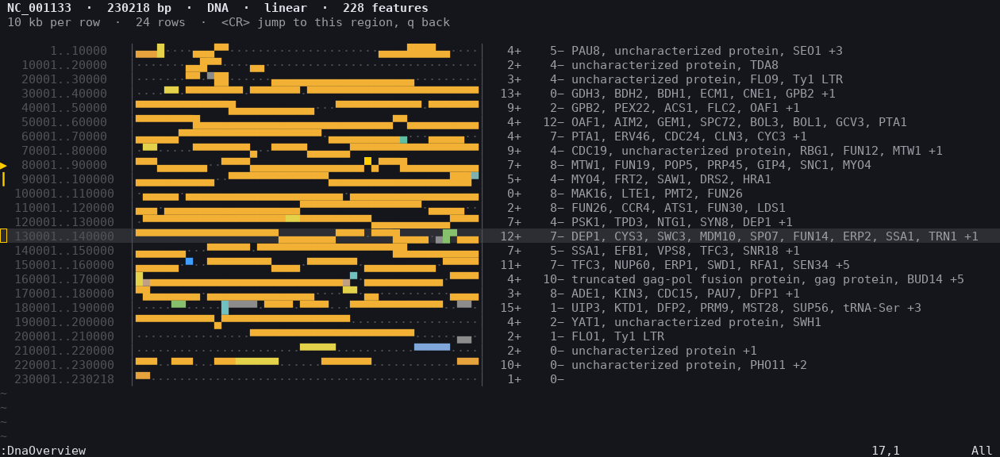
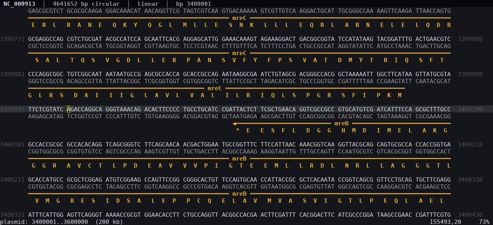

# A zoomed-out overview of a whole record

Scrolling a 4.6 Mb genome became cheap with the windowed linear layout, but
250,000 rows of sequence still give no way to see the shape of a record or to
get somewhere by eye. This track adds a view that trades the residues for the
shape: one row per fixed span, the whole record on one screen, and a jump from
any row into the sequence view.

Everything below was measured in this session, on this tree, with Neovim
0.12.2 on 12 cores.

## What it looks like



The genome at 200 kb per row, 140×32 terminal. Each row is a strip of 47
cells, one cell per 4.3 kb: the upper half block is a cell where only the
forward strand carries features, the lower half where only the reverse does, a
full block where both do, and a dot where neither does. Cells take the colour
of the highest-priority feature in them, from the same `priority` table and
`PlasmidFeature*` groups the linear and circular views use, so a CDS is a CDS
in every view. The numbers are the exact per-strand feature counts for the
span, and the rest of the row names as many of its features as fit. The yellow
`▶` in the gutter is the row the sequence view's cursor is on, `┃` the rest of
what it is showing.

A bacterial genome is mostly coding on both strands, and the picture says so;
the structure that shows is where the coding stops. A eukaryotic chromosome
has more to look at:



Saccharomyces chromosome I (NC_001133, 230,218 bp) at 10 kb per row: genes
sort visibly onto their strands, the subtelomeric repeats and Ty elements at
both ends are the grey and green cells, and the tRNAs are teal.

`<CR>` on a row puts the record back in the window at that region:



## The span rule

`overview.span = "auto"` picks the bases per row from the record and the
window:

    rows available = window height - 3 header rows - 1
    span           = ladder(ceil(record length / rows available))

where `ladder(n)` is the smallest number of the form 1, 2 or 5 times a power
of ten that is at least `n`, and never below `overview.min_span` (10). The
span is stated in the second header line ("200 kb per row  ·  24 rows"), and
the row coordinates are absolute positions in the record, never row numbers.

Measured, at 42 rows available:

| record | length | span | rows |
| --- | --- | --- | --- |
| a 300 bp insert | 300 | 10 bp | 30 |
| pBR322 (J01749) | 4,361 | 200 bp | 22 |
| yeast chromosome I | 230,218 | 10 kb | 24 |
| E. coli K-12 | 4,641,652 | 200 kb | 24 |
| E. coli K-12, 10-row window | 4,641,652 | 500 kb | 10 |

Rounding to 1/2/5 costs screen: 4,641,652 over 42 rows wants 110,516 bases per
row and gets 200,000, so 24 of the 42 rows are used. The alternative is a row
worth 110 kb, and then every coordinate in the view has to be divided by a
number nobody can divide by. A span you can do arithmetic with in your head is
worth more than the rows, and a user who disagrees writes
`:DnaOverview 110000` or sets `overview.span`. A forced span is taken as
given: the view is then as long as it needs to be and scrolls.

## Commands and keys

| | |
| --- | --- |
| `:DnaOverview` | open the overview over the record (again: close it) |
| `:DnaOverview {n}` | ... with `n` bases per row |
| `:DnaRegion {start}..{stop}` | go to a region of the record and select it |
| `gm` | open/close the overview (in a sequence buffer) |
| `<CR>` | in the overview: go to this region in the sequence view |
| `<LeftMouse>` | in the overview: go to the region under the pointer |
| `q` | in the overview: back, exactly where the sequence view was |

The overview takes over the window the record is in rather than opening a
split, because its promise is that the record fits on one screen and half a
screen halves every row's resolution. The window's view is saved on opening,
so `q` puts the sequence back on the same row with the same scroll position,
and `<CR>` puts it somewhere else on purpose. `gm` reopens the overview with
the marker wherever the sequence view now is, which is the round trip.

A click resolves inside the row: the cell under the pointer is worth
span/cells bases, so clicking three quarters along a 10 kb row lands within
about 200 bases of where you pointed, not at the start of the region
(measured: a click 29 cells along a 10 kb row landed on base 57,436 of
50,001..60,000).

## Config block

```lua
overview = {
  -- Bases per row. "auto" picks a round number (1, 2 or 5 times a power of
  -- ten) large enough for the record to fit in the window; a number forces
  -- that span, and the view scrolls if the record needs more rows.
  span = "auto",
  min_span = 10,            -- the finest span "auto" will pick
  strip = "auto",           -- columns of picture per row, or a number
  labels = true,            -- name the features in a row when there is room
  counts = true,            -- per-strand feature counts per row
  keymaps = {
    jump = "<CR>",          -- go to this region in the sequence view
    close = "q",            -- back to where the sequence view was
    click = "<LeftMouse>",  -- go to the region under the mouse
  },
},
keymaps = { overview = "gm" },   -- alongside the other views' keymaps
```

New highlight groups, all `default = true` like the rest:
`PlasmidOverviewCoord`, `PlasmidOverviewAxis`, `PlasmidOverviewEmpty`,
`PlasmidOverviewCount`, `PlasmidOverviewLabel`, `PlasmidOverviewViewport`,
`PlasmidOverviewCursor`. The cells themselves use the existing feature groups.

## Narrowing the linear view to a region

I did not narrow the layout, and I think a narrowing command would be a
mistake. Two measurements decide it. Jumping from the overview into a 4.6 Mb
genome took **3.5 ms** and raised the number of laid-out blocks from 58 to 105
of 92,834 — 393 of 456,794 rows have text in them after the jump. Going to a
region with `:DnaRegion 150000..151000` on the 230 kb chromosome laid out 31
of 4,605 blocks (153 of 23,083 rows). A region command cannot be cheaper than
that, because the windowed layout already only builds what a window shows.

What narrowing would cost is worse than nothing: a sub-record layout either
needs the linear view to grow a base offset (which I am not allowed to edit,
and which would put a second coordinate system through every position query,
every edit and every overlay), or it needs a sliced copy of the record, whose
coordinates then lie to the user and whose edits go to the wrong record.

So `:DnaRegion {start}..{stop}` exists, but it is navigation, not layout: it
puts the cursor at the start of the region and selects the region, so the
region is marked on the sequence and `y`, `ga`, `gp` and the rest act on it.
It is the one thing a jump does not already do.

## What the specs check

`tests/spec/overview_spec.lua`, 15 cases. Measured lines from the run:

    [overview] span ladder: 300 bp → 10, 230 kb → 10000, 4.64 Mb → 200000 bases per row (42 rows)
    [overview] row ↔ region is a bijection on 3 records, cells resolve inside a row
    [overview] 81 rows of 4 records: per-strand counts equal a direct count over 423 features
    [overview] rows fit 80, 100, 130 and 200 columns, highlights inside the text
    [overview] 73 files, 82 records (nucleotide, protein and empty), 1738 rows built
    [overview] a 14 kb viewport marks 2 rows plus the cursor's own
    [overview] NC_001133 (230218 bp, 325 features): 24 rows of 10 kb, 23 named, 1.2 ms
    [overview] NC_000913 (4641652 bp, 9285 features): 24 rows of 200 kb, 26 ms
    [overview] <CR> on row 9 landed on base 120001 of 120001..140000
    [overview] a click 15 cells along a 20 kb row landed on base 114286 of 100001..120000
    [overview] :DnaRegion 150000..151000 laid out 31 of 4605 blocks, 153 of 23083 rows

- **The span.** The ladder itself on eight values, and the span for five
  record/window pairs, including a 300 bp record (far smaller than a screen:
  10 bases per row) and a 4.64 Mb genome in a 42-row and in a 10-row window.
  Each case also asserts the record actually fits in the rows it was given. A
  configured span wins over the window.
- **Row ↔ region, both ways.** On three records, every row: `row_of_bp` of the
  first, middle and last base of a row is that row; consecutive rows leave no
  gap; the rows together cover exactly `rec:len()` bases, once. Columns inside
  the strip resolve to bases within the region, columns outside it to the
  region's start.
- **Density.** For every row of four records (81 rows, 423 features), the
  per-strand counts are compared with a direct overlap count taken from the
  record's own features, and the row's text is checked to show those numbers
  (a feature with no strand is counted on both: that is what the view says it
  means). Every feature reaches at least one row.
- **The commands.** `:DnaOverview` opens over the record with the cursor on
  the row the sequence view was looking at, and the buffer text equals the
  layout; running it again puts the record back with the cursor still on base
  123,456. `<CR>` is invoked through the keymap the user presses, lands inside
  the region it was on, and lands on a row with sequence on it (not a blank
  windowed row). A click lands where the column points. `:DnaOverview 1000`
  forces 231 rows of 1 kb on the 230 kb record and is allowed to overflow the
  screen. `gm` opens and `q` closes.
- **A 230 kb record.** NC_001133 builds in 1.2 ms as 24 rows of 10 kb, fits a
  46-row window, and names features on 23 of its 24 rows.
- **The whole fixture corpus.** 73 files, 82 records — protein, empty,
  SnapGene, multi-record FASTA — all build, all rows fit the width, the last
  row ends on the last residue.
- **Width and highlights.** At 80, 100, 130 and 200 columns no row is wider
  than the window and no highlight run reaches past its line.
- **The viewport marker.** Every row that overlaps the sequence view's visible
  range is marked and no other row is.
- A record far larger than one screen is also measured when
  `big/NC_000913.gbk` has been fetched; without it that case logs that it was
  skipped and the suite passes unchanged.

The suite as a whole, measured in this session:

| layout | result |
| --- | --- |
| default (`group = 10`) | **398 passed, 0 failed (126.2 s)** |
| continuous (`PLASMID_TEST_GROUP=0`) | **398 passed, 0 failed (126.1 s)** |

That is the 383 specs that were there plus the 15 of this spec, with
`big/NC_000913.gbk` present so the genome case measured rather than skipped.

## Cost on a real genome

`nvim -l tests/tools/overview_bench.lua big/NC_000913.gbk`, E. coli K-12
NC_000913.3 (4,641,652 bp, 9,285 features):

| step | time | heap |
| --- | --- | --- |
| parse | 827 ms | 55.3 MB |
| build the overview (140×32: 24 rows of 200 kb, 47 cells) | 25–27 ms | 1.7–2.1 MB |
| open the record (windowed, 456,794 rows, 92,834 blocks) | 1,186 ms | 43.5 MB |
| `:DnaOverview` on the open record | 25.6 ms | 1.6 MB |
| `<CR>` back into the sequence at 3.5 Mb | 3.5 ms | — |

After the jump, 393 of 456,794 rows are laid out; the process is at 88 MB of
Lua heap and 216 MB RSS. The overview itself is one pass over the feature list
and then only the cells a feature actually covers, so its cost follows the
feature count and the size of the picture, not the length of the record: the
same build on the 230 kb chromosome is 1.2 ms.

(The `:DnaOverview` line in the bench runs in a headless window of 11 text
rows, so it draws 10 rows of 500 kb rather than the 24 rows of 200 kb in the
screenshot. The time is the same either way — it is the feature pass, not the
rows.)

## Screenshots

Captured with the repo's existing `tests/tools/tui_capture.py`, which drives a
real Neovim in a pseudo-terminal and renders what the terminal received, at
140×32 with `laststatus=0` and `shortmess+=F` so no path appears anywhere on
the screen. The key sequences are in `tests/tools/overview_shots.txt` and
`tests/tools/overview_shots_yeast.txt`; the records are E. coli K-12 fetched
from NCBI and the committed yeast chromosome I fixture.

    nvim must be on PATH
    python3 tests/tools/tui_capture.py <record> <outprefix> --cols 140 --rows 32 \
        --script tests/tools/overview_shots.txt --pre "set laststatus=0" --pre "set shortmess+=F"

## What I did not do

- **No `:help` text and no README entry.** Both are yours; the commands, keys
  and config block above are what they need to describe.
- **The genome picture saturates.** At 4.3 kb per cell nearly every cell of
  E. coli contains a CDS on both strands, so the strip is mostly full blocks
  in CDS colour and the information in it is where the coding *stops*. That is
  true of the record rather than wrong of the view, but it means the strip
  earns its place on plasmids and chromosomes more than on a dense genome,
  where the counts and the names carry more. A density shading would say more
  there, but there is no half-height shade glyph, so it would cost the strand
  encoding.
- **The feature count in the title** is the drawn count (4,779 for E. coli),
  not the file's 9,285, because `dedupe_genes` collapses a gene onto its CDS.
  This matches the linear view's header; it is worth knowing when comparing
  the title with `:DnaInfo`.
- **No overview of a selection or of a feature type.** Filtering the strip by
  type (show me only the rRNAs) would be a natural next step and is not here.

## What I needed from the linear layout and did not have

Nothing that blocked me, and I edited neither `view/linear.lua` nor
`buffer.lua`. Two things I worked around:

1. **The visible base range of a window.** There is no "what is this window
   showing, in bases" call. I ask the layout row by row between `topline` and
   `botline` with `bp_at(row, prefix_w)` and take the extremes, which works
   for built and unbuilt rows alike but reaches into `lay.prefix_w` and
   assumes a column convention. A `lay:span_of_rows(row0, row1)` returning the
   first and last base, or a `buffer.visible_range(win)`, would be the honest
   version and would also serve the winbar.
2. **A layout-agnostic `bp_at`.** The circular layout may answer differently
   or not at all, so the viewport marker is wrapped in `pcall` and simply does
   not appear when the record is in the circular view. A shared "position
   under this row/column" contract across the two layouts would remove the
   `pcall`.

Neither is urgent: the first is five lines of duplication in
`lua/plasmid/overview.lua`, the second degrades to no marker.

## Files

- `lua/plasmid/view/overview.lua` — the layout: span rule, binning, rows,
  highlight runs, row ↔ region queries. No buffers.
- `lua/plasmid/overview.lua` — the view: opening over the record, the keys,
  the jump and the way back, `:DnaRegion`.
- `tests/spec/overview_spec.lua` — 15 cases.
- `tests/tools/overview_bench.lua`, `tests/tools/overview_shots*.txt` — the
  measurements and the screenshots above.
- `lua/plasmid/config.lua`, `lua/plasmid/init.lua`, `lua/plasmid/ui.lua`,
  `lua/plasmid/view/highlights.lua` — the config block, two commands, one
  keymap, seven highlight groups. Additive.
