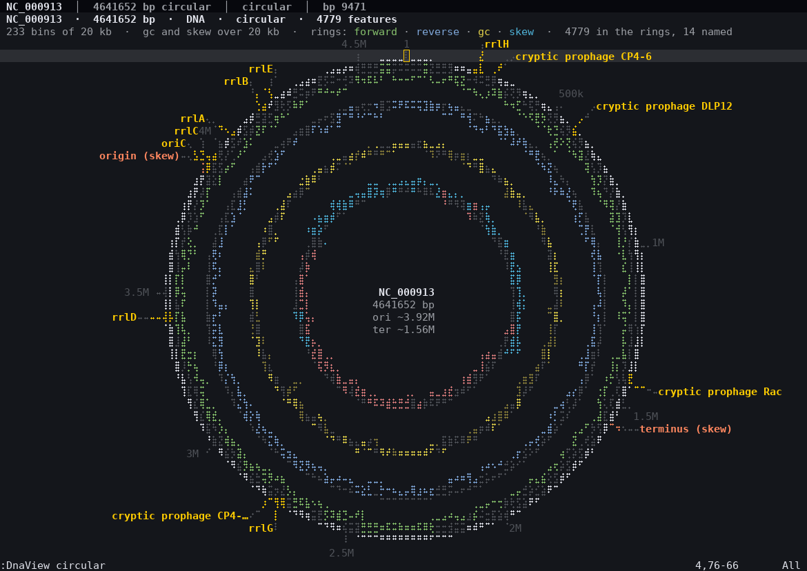

# The circular map at genome scale

The circular view draws one arc per feature. On a plasmid that is the right
picture and this track does not touch it. On *E. coli* K-12 it was not a
picture at all: the header read

    NC_000913  ·  4641652 bp  ·  DNA  ·  circular  ·  4779 features  (3749 over ring limit not on map)

so three quarters of the features were dropped to make room, what remained was
a solid band of braille because every angular step covered kilobases of a
genome that codes on both strands almost throughout, and a column of gene
names down the left said `tamB, metH, rpoB, ...` — whichever features came
first in priority order.

Above a threshold the map now draws a genome atlas instead: coordinate ticks
at a round interval, feature density per strand, GC content and GC skew per
angular bin, and a handful of landmarks worth naming. Nothing is dropped
without the header saying so.

Everything measured below was measured in one session on an idle 12-core
x86-64 machine with Neovim 0.12.2, against `big/NC_000913.gbk` (NC_000913.3,
4,641,652 bp) and `big/NC_001136.gbk` (NC_001136.10, 1,531,933 bp), fetched
with `tests/tools/fetch_big.sh`.

Two feature counts appear below and they are not the same number. The parser
reads **9,285** features from NC_000913.gbk; **4,779** of those are what any
view draws, because one is the `source` feature and the rest are `gene`
records whose location is identical to the CDS, mRNA, tRNA or rRNA they name
and which `dedupe_genes` folds into it. Every count in this report is the
second one, which is what the map's header has always counted.

`tests/tools/ring_bench.lua` prints every number in the tables.

## The rule for which picture you get

A feature can be drawn as its own arc while an arc is wider than a braille
dot. The ring on a 120x40 terminal is 434 braille dots around, so the scale at
which that stops being true is a few hundred bases per dot — around a
megabase of record, and a good deal lower once a genome is coding on both
strands and the arcs have to be packed into six rings as well.

The rule written into `circular.atlas`:

    circular = {
      atlas = {
        enabled = "auto",     -- "auto" | true | false
        threshold = 500000,   -- residues above which "auto" draws the atlas
        landmarks = 12,       -- most features named on the ring
      },
    }

`"auto"` decides on the record's length alone, deliberately: a rule that also
read the window size would change what the map *is* when a window is resized.
`true` and `false` force it either way, which is how a plasmid can be looked
at as an atlas and a chromosome as arcs.

500,000 is where a record stops being something a reader points at feature by
feature. Below it the committed corpus lives — the largest fixture is yeast
chromosome I at 230,218 bp — and above it sit bacterial chromosomes,
eukaryotic chromosomes and the large viruses. The suite asserts that no
committed fixture is over the threshold, so the whole corpus is still drawn
the old way.

## What the rings are

Outermost first, inside the backbone:

| ring | what it is | how to read it |
|---|---|---|
| forward | features covering each bin on the forward strand | a profile inwards from its baseline, tallest at the busiest bin |
| reverse | the same for the reverse strand | the two rings share one scale, so they can be compared |
| gc | GC content of each bin, against the record's mean | outwards above the mean, inwards below |
| skew | GC skew (G−C)/(G+C) of each bin | outwards positive, inwards negative |

A bin is a round number of bases — the finest of 1, 2, 2.5 or 5 times a power
of ten that puts at most one bin in each character cell around the ring — and
the same bin is the window GC and skew are measured over, so the header states
one number for both. GC is (G+C)/(A+C+G+T): ambiguity codes count towards
neither, and a bin with no unambiguous bases is drawn as nothing rather than
as zero.

The rings are drawn as step profiles, not as filled bars. A braille cell is
2x4 dots, and a bar filled at this width renders as a solid block — the first
version of this ring was a wall of `⣿` and read as exactly the blob the atlas
is here to replace.

Each ring gets shorter bars as the window shrinks, and then the rings go, from
the inside out. When any ring is missing the colour key in the header stops
being optional and names the ones that are there:

| window | bins | rings drawn | header, second row |
|---|---|---|---|
| 130x46 | 233 of 20 kb | 4 | `233 bins of 20 kb · gc and skew over 20 kb · rings: forward · reverse · gc · skew · 4779 in the rings, 14 named` |
| 120x40 | 186 of 25 kb | 4 | `186 bins of 25 kb · gc and skew over 25 kb · rings: forward · reverse · gc · skew · 4779 in the rings, 14 named` |
| 90x28 | 93 of 50 kb | 4 | `93 bins of 50 kb · gc and skew over 50 kb · 4779 in the rings, 14 named` |
| 60x20 | 47 of 100 kb | 2 | `47 bins of 100 kb · rings: forward · reverse · 4779 in the rings, 13 named, 1 with no room to name` |

At 60 columns that last line is 103 columns long. The accounting and the ring
key are the two things that may not be dropped, so in a window that narrow the
header runs past the right edge rather than quietly saying less.

## Ticks

Plasmid scale keeps the intervals it had: eight of them, which is a kilobase
on pBR322. Genome scale asks for ten, because at that size the ring carries
coordinates rather than names, and ten lands *E. coli* on half-megabase marks.
Measured (`ring.tick_step`):

| record | bp | scale | interval |
|---|---|---|---|
| pBR322 | 4,361 | arcs | 1,000 |
| pPCP1 | 9,609 | arcs | 2,000 |
| yeast chromosome I | 230,218 | arcs | 50,000 |
| synthetic | 600,000 | atlas | 100,000 |
| yeast chromosome IV | 1,531,933 | atlas | 200,000 |
| E. coli K-12 | 4,641,652 | atlas | 500,000 |
| S. coelicolor | 8,667,507 | atlas | 1,000,000 |

Every interval is 1, 2, 2.5 or 5 times a power of ten, and between four and
twelve of them cover the record; the spec checks both over that range of
sizes.

## GC skew against E. coli

The forward strand is the leading strand from the replication origin round to
the terminus and the lagging strand on the way back, so the running sum of
(G−C) falls to its minimum at the origin and rises to its maximum at the
terminus. The map marks both, names them `origin (skew)` and
`terminus (skew)`, and prints them in the middle of the ring.

Measured on NC_000913.3, against the annotated `oriC` at 3,925,744..3,925,975
and the *dif* site at about 1,588,800:

| window | bin | skew minimum | distance from oriC | skew maximum | distance from dif |
|---|---|---|---|---|---|
| 120x40 | 25 kb | 3,925,000 | 744 bp | 1,550,000 | 38,800 bp |
| 130x46 | 20 kb | 3,920,000 | 5,744 bp | 1,560,000 | 28,800 bp |
| 60x20 | 100 kb | 3,900,000 | 25,744 bp | 1,600,000 | 11,200 bp |

The origin lands inside one bin of `oriC` at every window size — at 25 kb bins
within 744 bp of it, which is closer than the bin is wide and is luck as much
as resolution. The terminus lands 11–39 kb from *dif*, between 0.2% and 0.8%
of the genome away. That is the honest answer rather than a miss: the
replication fork trap is a region of the chromosome hundreds of kilobases
across, and the point where the cumulative skew turns is where the two forks
meet, not the *dif* site itself.

The map does not claim an origin it cannot see. The claim is made only for a
circular DNA record whose cumulative skew swings by at least 0.4% of its
length. Measured swings:

| record | swing | % of length | claimed |
|---|---|---|---|
| E. coli K-12, 25 kb bins | 39,203 | 0.845% | yes |
| synthetic 600 kb with a built-in signal | 32,676 | 5.446% | yes |
| synthetic 600 kb, strands balanced | 651 | 0.108% | no |
| yeast chromosome IV (linear) | 4,518 | 0.295% | no, and linear anyway |

0.4% sits between the random walk a balanced sequence gives at the smallest
size the atlas is used at and what a real chromosome gives. The margin is
about eight times at the bottom and two at the top, and it grows with length:
a random walk's swing goes as the square root of the record, so as a fraction
of the record it falls as records get larger, while a replication signal does
not.

## Landmarks

What gets named is chosen by worth, not by the order features happen to come
in. A feature scores its type's own standing — a replication origin 1000, an
rRNA 600, an ncRNA 150, a mobile element 120, anything else 0 — plus up to 300
for its length as a fraction of the largest feature on the record. Neighbours
of the same type within two bins (or ten kilobases, whichever is larger) are
one landmark, named after the best-scoring of them.

On *E. coli* at 120x40 that gives, in order: `oriC`, then six of the seven
rRNA operons as single labels rather than twenty-two rRNA genes, then the
largest cryptic prophages — `CP4-6` (34,308 bp), `Rac`, `CP4-57`, `DLP12`,
`Qin`. The merge distance follows the bin, so at 25 kb bins the *rrnB* and
*rrnE* operons, whose midpoints are 41 kb apart, read as one landmark and the
twelfth slot goes to a prophage; at 130x46, where the bin is 20 kb, all seven
operons are named and `Qin` is not. Both are visible in the screenshot and in
`ring_bench.lua` output.

The two skew turning points are named on top of the twelve, so the map carries
fourteen names where it used to carry a column of arbitrary ones.

## Nothing goes missing

At any scale the first header row counts every feature the linear view would
show, and the second says what became of each one. A feature is in exactly one
of: the rings, the annotation-history types the map hides
(`circular.hidden_types`), or past the end of the sequence. At plasmid scale
there is a fourth, the features over the ring limit, which is the line the old
header already had.

That last class was the one real bug found on the way: a feature whose
location lies beyond the sequence — a GenBank CON record with no residues, a
truncated file — was dropped from the map silently and then reported in the
header as annotation history, which it is not. It is now counted and named
separately. This is the only change to what any plasmid-scale record renders
(see below).

The suite builds a 600 kb record with 50 ordinary features, 3 of a hidden type
and 2 past the end of the sequence, and asserts the title says `55 features`,
that 50 + 3 + 2 = 55, and that the second row carries `50 in the rings`,
`3 annotation history` and `2 past the sequence end`.

## A plasmid is drawn exactly as it was

Proof, not assertion: every record in `tests/fixtures` was rendered through
`view.circular` at five window sizes (80x24, 100x40, 120x40, 160x50, 60x20),
before any change and after all of them, keeping the lines and the per-row
highlight runs. **525 renders; 515 byte-identical; 10 changed.** The ten are
the two zero-residue CON records at all five sizes, and the whole change is
the header correction above:

    - NZ_JCEXQL010000002  ·  0 bp  ·  DNA  ·  circular  ·  45 features  (45 annotation-history not on map)
    + NZ_JCEXQL010000002  ·  0 bp  ·  DNA  ·  circular  ·  45 features  (45 past the sequence end not on map)

Nothing else moved: not a dot, not a label, not a highlight run. That holds
across a refactor that pulled the label columns, the backbone, the ticks, the
overlays and the centre text out of `M.build` so both scales could share them.

`ring_spec` keeps it that way with checksums of the rendered lines for pBR322
at 120x40 and 80x24, pUC19 at 120x40 and pPCP1 at 100x40, and by asserting
that no `PlasmidRing*` highlight group ever appears on a plasmid.

## What it costs

| record | window | scale | parse | first build | second build |
|---|---|---|---|---|---|
| pBR322, 4,361 bp | 120x40 | arcs | 5 ms | 9 ms | 6 ms |
| yeast chromosome I, 230,218 bp | 120x40 | arcs | 50 ms | 13 ms | 8 ms |
| yeast chromosome IV, 1,531,933 bp | 120x40 | atlas | 273 ms | 112 ms | 18 ms |
| E. coli K-12, 4,641,652 bp | 120x40 | atlas | 876 ms | 322 ms | 51 ms |
| E. coli K-12 | 130x46 | atlas | 884 ms | 333 ms | 56 ms |
| E. coli K-12 | 60x20 | atlas | 837 ms | 318 ms | 45 ms |

The first build of a genome reads the whole sequence to count G, C and A/T per
bin; the heap it adds is 2 MB on top of the 45 MB the parsed record holds. The
counting is cached on the record against its revision and bin width, so a
second build at the same window is 51 ms — a resize that lands on the same
round bin width pays nothing for the composition, and one that changes the
bin pays it again: the counting alone is 270 ms at 25 kb bins and 275 ms at
20 kb.

For comparison, the old arc-drawing path on the same genome and window built
in 65 ms, having thrown 3,749 features away. The atlas costs about five times
that on the first build and keeps all of them.

## What I could not do

- **No second real genome for the skew check.** Only *E. coli* has a
  replication origin annotated in the corpus and known independently. Yeast
  chromosome IV is in the tables as a negative control (linear, and below the
  swing floor), but a second bacterial chromosome — *B. subtilis*, say — would
  be a better check of the origin/terminus claim than one genome plus a
  synthetic.
- **The terminus is only approximately where the biology says.** 11–39 kb
  depending on the bin. I have no way to narrow that without a finer bin than
  the ring can draw, and reporting an origin to a precision the picture does
  not have would be worse than the spread.
- **Restriction sites are drawn but not labelled at genome scale.** The cut
  marks still appear if `gz` is on; naming them is left out because a genome
  has thousands. They are listed in the enzyme panel, so nothing is lost, but
  the atlas header does not account for them the way it accounts for features.
- **The skew rule assumes the usual deposition.** Minimum at the origin,
  maximum at the terminus holds when the forward strand is the leading strand
  leaving the origin, which is how chromosomes are normally deposited. A
  record laid down the other way round would have the two labels swapped. The
  map says `(skew)` on both labels, which is the most it can honestly claim.
- **A 60-column window overflows the header.** The accounting and the ring key
  are both mandatory, and together they are longer than 60 columns. The line
  runs off the edge rather than dropping something.
- **No screenshot of the atlas at a small window.** One capture, the one the
  README uses.
